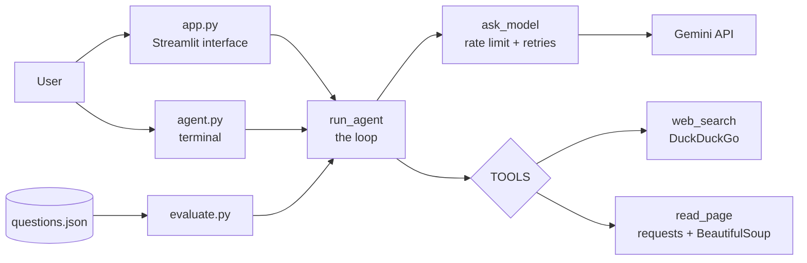

# Architecture and Growth Plan

This document explains how the Research Agent is built today, and how the repository can grow from here.

## 1. How it works today

### The core idea (simple case)

An agent is a loop. For the question *"Who won the 2025 Ballon d'Or?"*:

| Step | Who acts | What happens |
|------|----------|--------------|
| 1 | Model | Decides it needs facts and asks for `web_search` |
| 2 | Code | Runs the search and sends the results back |
| 3 | Model | Picks a promising link and asks for `read_page` |
| 4 | Code | Downloads the page, cleans the text, sends it back |
| 5 | Model | Writes the final answer with source URLs |

The model never runs code. It only *asks*; `agent.py` decides what actually runs.

### Components



### Files

| File | Role |
|------|------|
| `agent.py` | The agent: tools, model calls, and the loop (`run_agent`) |
| `app.py` | Streamlit interface; shows each step live through the `on_step` callback |
| `evaluate.py` | Runs the agent on `questions.json` and reports a score |
| `questions.json` | Test questions with an expected keyword each |
| `requirements.txt` | Python dependencies |
| `.env` (not in git) | Holds `GEMINI_API_KEY` |

### Design decisions

- **Tools live in a dictionary (`TOOLS`).** Adding a tool means writing a function and adding one entry, with no change to the loop.
- **Tool errors are returned as text**, not raised. The model reads "Search failed..." and can try something else.
- **`MAX_STEPS` caps the loop**, so a confused agent cannot run forever or burn the quota.
- **`ask_model` enforces a minimum gap between calls** and retries on 503, 429 and empty replies, because the free tier allows about 15 requests per minute.
- **`on_step` is an optional callback**, so the same loop serves the terminal and the web page.

### Known limitations (be honest about these)

- The free-tier model sometimes returns a malformed tool call (`MALFORMED_FUNCTION_CALL`). The agent retries, but a question can still fail.
- `final_config` is meant to force a final answer without tools. An earlier version of it (tools declared, calls forbidden) did not stop tool calls. The current version declares no tools, and **it has not been verified on a failing run yet**.
- The model sometimes sends `queries` (a list) instead of `query`. `run_agent` translates it, which is a workaround, not a cure.
- Evaluation uses keyword matching on 14 questions. Some questions can be answered from model memory without searching, so the score overstates tool use.
- DuckDuckGo search is unofficial and sometimes returns "No results" for quoted or `site:` queries.

## 2. Growth plan

Each phase is small enough to finish in one or two sessions. Do them in order; every phase ends with a commit.

### Phase 1: Tidy the repo
- [ ] Add `.env.example` containing `GEMINI_API_KEY=your_key_here`
- [ ] Remove `test_key.py` and `test_search.py`, or move them into `tests/`
- [ ] Add a `LICENSE` (MIT is a common choice)
- [ ] Add the architecture diagram above to the README, or link to this file

### Phase 2: Make it trustworthy
- [ ] Verify the `final_config` fallback on a failing question, and record the result here
- [ ] Extend `evaluate.py` to also check that the answer contains a URL
- [ ] Grow `questions.json` to about 30 questions, with at least half requiring a search
- [ ] Save each evaluation run to `results/` with the date, so scores can be compared over time

### Phase 3: Give it more abilities
- [ ] A third tool, such as a calculator or a Wikipedia lookup
- [ ] Multi-turn chat in Streamlit, so follow-up questions keep context
- [ ] Show sources as a separate list under the answer

### Phase 4: Make it independent of one provider
- [ ] Move model calls behind one small interface (`ask_model`) with a Gemini implementation
- [ ] Add a second implementation (another provider, or a local model)
- [ ] Compare both on `questions.json` and put the table in the README

### Phase 5: Make it a real project
- [ ] Split `agent.py` into `tools.py`, `model.py` and `loop.py` once it passes about 250 lines
- [ ] Add `pytest` tests for tools that do not need the model (`read_page`, the `queries` translation)
- [ ] Add a GitHub Actions workflow that installs dependencies and runs those tests
- [ ] Optional: deploy the Streamlit app

## 3. Git workflow

### Simple case first: one change, one commit

```text
edit files -> git add . -> git status (check no .env) -> git commit -m "..." -> git push
```

### Commit messages

Use a short prefix, as in the history so far:

| Prefix | Use for | Example |
|--------|---------|---------|
| `feat:` | A new capability | `feat: add calculator tool` |
| `fix:` | A bug fix | `fix: handle empty search query` |
| `docs:` | README or this file | `docs: add architecture diagram` |
| `test:` | Tests and evaluation | `test: grow question set to 30` |
| `refactor:` | Reorganizing without changing behaviour | `refactor: split agent.py` |

### Branches (from Phase 3 onward)

Once the project has users or you start larger changes, work on a branch so `main` always works.

```bash
git switch -c feat/calculator-tool    # create and switch to a branch
# edit, commit as usual
git push -u origin feat/calculator-tool
# open a Pull Request on GitHub, review it, merge, then:
git switch main
git pull
```

### Tags for milestones

```bash
git tag v1.0 -m "Search + read page + Streamlit + evaluation"
git push origin v1.0
```

Suggested tags: `v1.0` (current state), `v1.1` (after Phase 2), `v2.0` (after Phase 4).

### Tracking work

Create one GitHub Issue per checkbox above, and group them in Milestones named after the phases. That gives visitors a visible roadmap.

## 4. Rules that protect the project

- `.env` and `.venv/` stay in `.gitignore`. Run `git status` before every commit.
- If an API key ever reaches GitHub, delete that key in the provider's console right away, then create a new one.
- Re-run `evaluate.py` once after any change to the prompt or tools, and note the score. Do not run it repeatedly, since it spends free-tier quota.
